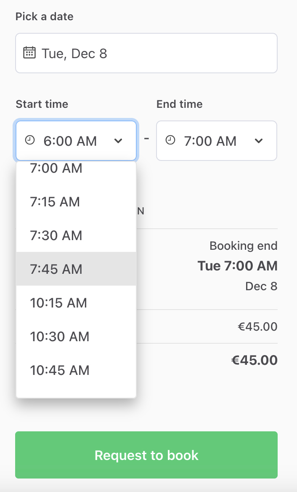

import { FileTree } from 'nextra/components';

# Add buffer time to bookings in time-based listings

For some services booked by the hour, the listing author may want to
reserve a buffer time between bookings. For instance a bike rental
agency may want to check their bikes between rentals, or a massage
therapist may need to clear up and restock their therapy space before
the next customer arrives. You can set your marketplace to add these
kinds of buffers by default, so listing authors do not need to add
availability exceptions manually.

## Add a 15 minute buffer between one hour bookings

The simplest use case for buffered bookings is having one hour slots
that are bookable at the top of the hour, and adding 15 minutes of
non-bookable time after each slot. To achieve that, we will use the
booking's display times.

A booking has a start time and an end time, and it can also have a
display start time and a display end time. We save the booking end time
with the buffer added, so that other customers can't book over the
buffer. The times the customer selected are saved as the display times,
and the order breakdown shows those to the customer and the provider.

### Add buffer helpers to dates.js

<FileTree>
  <FileTree.Folder name="src" defaultOpen>
    <FileTree.Folder name="util" defaultOpen>
      <FileTree.File name="dates.js" />
    </FileTree.Folder>
  </FileTree.Folder>
</FileTree>

First, let's add the buffer length and a helper function to
`src/util/dates.js`. The helper takes the booking dates the customer
selected. It adds the buffer to the booking end time, and saves the
selected times as display times. If there are no booking dates, it
returns an empty object.

{/* prettier-ignore */}
```jsx filename="src/util/dates.js" {4-17}
export const START_DATE = 'startDate';
export const END_DATE = 'endDate';

export const bufferMinutes = 15;

// Add the buffer to the booking end time, and use the selected times as display times
export const addBufferToBookingDates = bookingDates =>
  bookingDates
    ? {
        ...bookingDates,
        bookingEnd: moment(bookingDates.bookingEnd)
          .add(bufferMinutes, 'minutes')
          .toDate(),
        bookingDisplayStart: bookingDates.bookingStart,
        bookingDisplayEnd: bookingDates.bookingEnd,
      }
    : {};
```

### Add the buffer to bookings in CheckoutPage.duck.js

<FileTree>
  <FileTree.Folder name="src" defaultOpen>
    <FileTree.Folder name="containers" defaultOpen>
      <FileTree.Folder name="CheckoutPage" defaultOpen>
        <FileTree.File name="CheckoutPage.duck.js" />
      </FileTree.Folder>
    </FileTree.Folder>
  </FileTree.Folder>
</FileTree>

The checkout page passes the selected booking dates to the Marketplace
API in two places. `speculateTransactionPayloadCreator` fetches the
price breakdown before the customer confirms the order, and
`initiateOrderPayloadCreator` creates the transaction. We add the buffer
in both, so that the price breakdown and the actual transaction use the
same booking times.

First, let's import the helper.

{/* prettier-ignore */}
```jsx filename="src/containers/CheckoutPage/CheckoutPage.duck.js" {2}
import * as log from '../../util/log';
import { addBufferToBookingDates } from '../../util/dates';
import { setCurrentUserHasOrders, fetchCurrentUser } from '../../ducks/user.duck';
```

Then, we use it in `initiateOrderPayloadCreator` instead of the plain
booking dates.

{/* prettier-ignore */}
```jsx filename="src/containers/CheckoutPage/CheckoutPage.duck.js" {7}
const initiateOrderPayloadCreator = (
  { orderParams, processAlias, transactionId, transitionName, isPrivilegedTransition },
  { dispatch, extra: sdk, rejectWithValue }
) => {
  /* ... */
  const quantityMaybe = quantity ? { stockReservationQuantity: quantity } : {};
  const bookingParamsMaybe = addBufferToBookingDates(bookingDates);
```

Finally, we make the same change in
`speculateTransactionPayloadCreator`.

{/* prettier-ignore */}
```jsx filename="src/containers/CheckoutPage/CheckoutPage.duck.js" {7}
const speculateTransactionPayloadCreator = (
  { orderParams, processAlias, transactionId, transitionName, isPrivilegedTransition },
  { dispatch, extra: sdk, rejectWithValue }
) => {
  /* ... */
  const quantityMaybe = quantity ? { stockReservationQuantity: quantity } : {};
  const bookingParamsMaybe = addBufferToBookingDates(bookingDates);
```

### Calculate the price without the buffer in lineItems.js

<FileTree>
  <FileTree.Folder name="server" defaultOpen>
    <FileTree.Folder name="api-util" defaultOpen>
      <FileTree.File name="lineItems.js" />
    </FileTree.Folder>
  </FileTree.Folder>
</FileTree>

By default, the price of an hourly booking is calculated from the
booking's start and end times. The booking end time now includes the
buffer, but the customer should only pay for the time they selected. So
in `getHourQuantityAndLineItems`, we calculate the quantity until the
display end time.

The listing page also calculates a price estimate with the same
function, before there are any display times. In that case, we use the
booking end time as before.

{/* prettier-ignore */}
```jsx filename="server/api-util/lineItems.js" {2-3,6}
const getHourQuantityAndLineItems = orderData => {
  const { bookingStart, bookingEnd, bookingDisplayEnd, seats } = orderData || {};
  const end = bookingDisplayEnd ?? bookingEnd;
  const hasSeats = !!seats;
  const units =
    bookingStart && end ? calculateQuantityFromHours(bookingStart, end) : null;
```

### Leave room for the buffer in FieldDateAndTimeInput.js

<FileTree>
  <FileTree.Folder name="src" defaultOpen>
    <FileTree.Folder name="components" defaultOpen>
      <FileTree.Folder name="OrderPanel" defaultOpen>
        <FileTree.Folder name="BookingTimeForm" defaultOpen>
          <FileTree.File name="FieldDateAndTimeInput.js" />
        </FileTree.Folder>
      </FileTree.Folder>
    </FileTree.Folder>
  </FileTree.Folder>
</FileTree>

The booking form shows start and end times based on the listing's free
time slots. Each booking now needs 15 minutes of free time after the
selected end time. So we need to remove the start and end times that
don't leave room for the buffer. Otherwise, the customer could select
times that overlap the next booking or the end of the availability, and
the transaction can't be created.

First, let's import `bufferMinutes` and `bookingTimeUnits`.

```jsx filename="src/components/OrderPanel/BookingTimeForm/FieldDateAndTimeInput.js" {4-5}
import {
  getStartHours,
  getEndHours,
  bufferMinutes,
  bookingTimeUnits,
```

Then, right after the imports, let's set the shortest booking length
including the buffer: one hour and 15 minutes.

{/* prettier-ignore */}
```jsx filename="src/components/OrderPanel/BookingTimeForm/FieldDateAndTimeInput.js" {3-4}
import css from './FieldDateAndTimeInput.module.css';

// The shortest booking is one hour, and the buffer comes after it
const bookingWithBufferInMinutes = bookingTimeUnits.hour.timeUnitInMinutes + bufferMinutes;
```

In `getAvailableStartTimes`, we keep the start times that leave room for
a one hour booking and the buffer before the time slot ends.

{/* prettier-ignore */}
```jsx filename="src/components/OrderPanel/BookingTimeForm/FieldDateAndTimeInput.js" {5-9}
    // If date next to selected start date is inside timeslot use the next date to get the hours of full day.
    // Otherwise use the end of the timeslot.
    const endLimit = isDateSameOrAfter(endDate, nextDate) ? nextDate : endDate;

    // Start times need room for a one hour booking and the buffer
    const latestStart = getStartOf(endDate, 'minute', timeZone, -bookingWithBufferInMinutes, 'minutes');
    const hours = getStartHours(startLimit, endLimit, timeZone, intl).filter(
      boundary => boundary.timestamp <= latestStart.getTime()
    );
    return availableHours.concat(hours);
  }, []);
  return allHours;
```

Finally, in `getAvailableEndTimes`, we keep the end times that leave
room for the buffer before the time slot ends.

{/* prettier-ignore */}
```jsx filename="src/components/OrderPanel/BookingTimeForm/FieldDateAndTimeInput.js" {8-12}
    // If the selected end date is on the same day as timeslot end, use the timeslot end.
    // Else use the start of the next day after selected date.
    endLimit = isSameDate(getStartOf(endDate, 'day', timeZone), startOfEndDay)
      ? endDate
      : dayAfterBookingEnd;
  }

  // End times need room for the buffer
  const latestEnd = getStartOf(endDate, 'minute', timeZone, -bufferMinutes, 'minutes');
  return getEndHours(startLimit, endLimit, timeZone, intl).filter(
    boundary => boundary.timestamp <= latestEnd.getTime()
  );
};
```

Now, if someone has booked 6 PM to 7 PM, the listing is booked until
7:15 PM. Another customer can't book 5 PM to 6 PM, because the buffer
after it would overlap the 6 PM booking. After the 6 PM booking, the
next available start time is 8 PM.

## Allow users to book buffered appointments at non-sharp hours

With start times only at the top of the hour, the time between the
buffer and the next full hour stays unbooked. For example, if someone
books the 8 AM - 9 AM slot, the listing is booked until 9:15 AM, and the
next available start time is 10 AM. If we do not want to leave extra
gaps between bookings beyond the buffer, we can let bookings start at
any quarter hour. That way, the next available start time is 9:15 AM,
right after the buffer.

In other words, we need to have start and end times at a different
cycle:

- start times at 15 minute increments, i.e. a customer can start their
  booking at any quarter hour, instead of at the top of the hour only
- end times at one hour increments from the start time, i.e. the
  customer can book one or more full hours only.

This section builds on the previous section, and all changes are in the
booking form.

### Start bookings at any quarter hour in FieldDateAndTimeInput.js

<FileTree>
  <FileTree.Folder name="src" defaultOpen>
    <FileTree.Folder name="components" defaultOpen>
      <FileTree.Folder name="OrderPanel" defaultOpen>
        <FileTree.Folder name="BookingTimeForm" defaultOpen>
          <FileTree.File name="FieldDateAndTimeInput.js" />
        </FileTree.Folder>
      </FileTree.Folder>
    </FileTree.Folder>
  </FileTree.Folder>
</FileTree>

The `getStartHours` and `getEndHours` functions only return full hours.
The template also has `getStartBoundaries` and `getEndBoundaries`
functions, which work the same way, but take a time unit as an
additional parameter. First, let's import them instead.

```jsx filename="src/components/OrderPanel/BookingTimeForm/FieldDateAndTimeInput.js" {2-3}
import {
  getStartBoundaries,
  getEndBoundaries,
  bufferMinutes,
  bookingTimeUnits,
```

Then, let's add two constants after `bookingWithBufferInMinutes`. For
start times, we use the template's 15 minute `quarterHour` time unit,
because it matches the buffer length. For end times, we need the length
of an hour in milliseconds.

{/* prettier-ignore */}
```jsx filename="src/components/OrderPanel/BookingTimeForm/FieldDateAndTimeInput.js" {3-5}
// The shortest booking is one hour, and the buffer comes after it
const bookingWithBufferInMinutes = bookingTimeUnits.hour.timeUnitInMinutes + bufferMinutes;
// Bookings can start at any quarter hour, and they last full hours
const startTimeUnit = bookingTimeUnits.quarterHour;
const bookingUnitInMs = bookingTimeUnits.hour.timeUnitInMinutes * 60 * 1000;
```

In `getAvailableStartTimes`, we replace `getStartHours` with
`getStartBoundaries` and pass the quarter hour time unit. The filter
from the previous section still removes the start times that don't leave
room for a one hour booking and the buffer.

{/* prettier-ignore */}
```jsx filename="src/components/OrderPanel/BookingTimeForm/FieldDateAndTimeInput.js" {3}
    // Start times need room for a one hour booking and the buffer
    const latestStart = getStartOf(endDate, 'minute', timeZone, -bookingWithBufferInMinutes, 'minutes');
    const hours = getStartBoundaries(startLimit, endLimit, timeZone, intl, startTimeUnit.timeUnit).filter(
      boundary => boundary.timestamp <= latestStart.getTime()
    );
    return availableHours.concat(hours);
  }, []);
  return allHours;
```

In `getAvailableEndTimes`, we also use quarter hour boundaries. Then we
keep the ones that are a full number of hours after the booking start.
This way, a booking that starts at 10:15 AM can end at 11:15 AM or 12:15
PM, but not at 11 AM.

{/* prettier-ignore */}
```jsx filename="src/components/OrderPanel/BookingTimeForm/FieldDateAndTimeInput.js" {1-2,4-7}
  // End times need room for the buffer, and they are full hours after the booking start
  const bookingStartTimestamp = bookingStartTimeAsDate.getTime();
  const latestEnd = getStartOf(endDate, 'minute', timeZone, -bufferMinutes, 'minutes');
  return getEndBoundaries(startLimit, endLimit, timeZone, intl, startTimeUnit.timeUnit).filter(
    boundary =>
      boundary.timestamp <= latestEnd.getTime() &&
      (boundary.timestamp - bookingStartTimestamp) % bookingUnitInMs === 0
  );
};
```

Now, if we have a booking from 9 AM to 10 AM with a 15 minute buffer at
the end, the next customer can start their booking at 10:15 AM.
Conversely, the previous booking can begin 7:45 AM and no later, so that
the buffered time slot can fit in before the already booked session.


