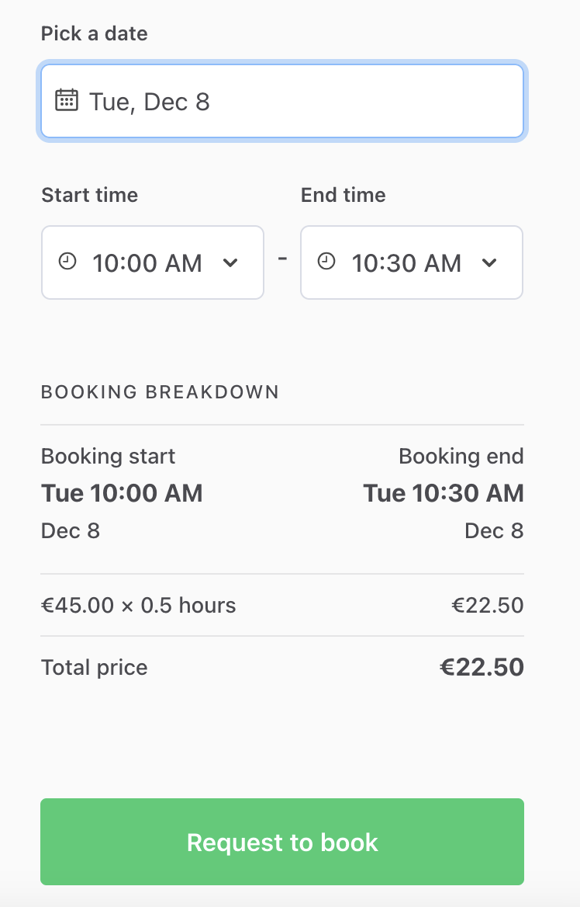
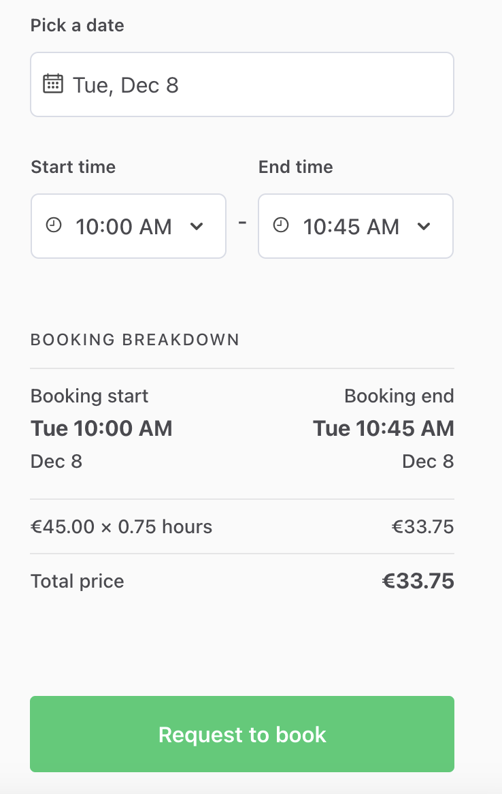
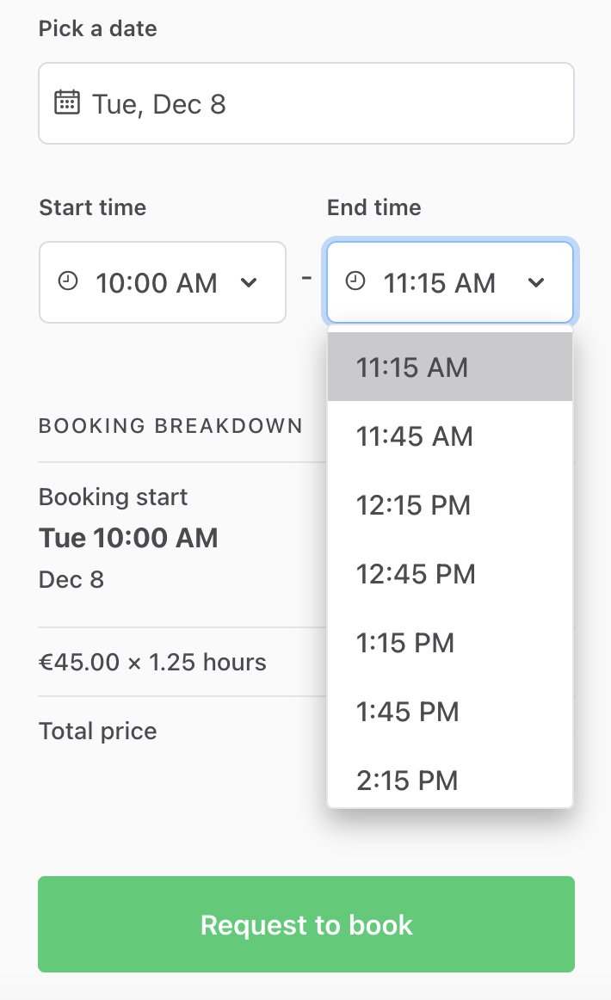

import { Callout, FileTree } from 'nextra/components';

# Modify booking time intervals in time-based listings

In Sharetribe, listings can have either day-based or time-based
availability. For listings with time-based availability, the available
[time slots](https://www.sharetribe.com/api-reference/marketplace.html#time-slots)
are returned from the API as continuous stretches of time. The client
application must therefore split the availability into suitable booking
lengths.

The default behavior of the Sharetribe Web Template hourly listings is
to split the continuous availability stretch into one hour bookable
intervals. This how-to guide illustrates a handful of different cases on
modifying booking lengths. These changes apply to all listings where the
unit type is set to "hour".

<Callout type="info">

The Sharetribe Web Template also supports fixed timeslots, where the
provider can choose the length of possible bookings, and the customer
only selects a start time for their booking. This guide applies to
non-fixed time slots, where the customer can select multiple intervals
of the available booking length by setting a start time and an end time.

This guide builds on top of release
[v12.5.0](https://github.com/sharetribe/web-template/releases/tag/v12.5.0).
If you are working on an earlier version, you will need to apply some of
the changes from that version to support this use case in your template.

</Callout>

## Set booking length to 30 minutes

The simplest use case is to create uniform 30 minute booking slots
instead of hour long slots.

### Use non-hour duration in FieldDateAndTimeInput.js

The `src/util/dates.js` file exports a `bookingTimeUnits` object that
describes time units used in the template. We can import
`bookingTimeUnits` in
`src/components/OrderPanel/BookingTimeForm/FieldDateAndTimeInput.js`, so
that we can replace usages of hard-coded 'hour' with a duration set as
one of the defined booking time units.

<FileTree>
  <FileTree.Folder name="src" defaultOpen>
    <FileTree.Folder name="components" defaultOpen>
      <FileTree.Folder name="OrderPanel" defaultOpen>
        <FileTree.Folder name="BookingTimeForm" defaultOpen>
          <FileTree.File name="FieldDateAndTimeInput.js" />
        </FileTree.Folder>
      </FileTree.Folder>
    </FileTree.Folder>
  </FileTree.Folder>
</FileTree>

In addition, we want to import the functions `getStartBoundaries` and
`getEndBoundaries` to replace the hour-based `getStartHours` and
`getEndHours` so that we can use the half hour time unit.

```jsx filename="src/components/OrderPanel/BookingTimeForm/FieldDateAndTimeInput.js" {2-4}
import {
  getStartBoundaries,
  getEndBoundaries,
  bookingTimeUnits,
```

Then, let's set the `halfHour` time unit to a variable `duration`. This
will make it easier to change the length of the duration later. We'll
define this right after the imports.

We also set a variable `minDurationInMinutes` for the shortest bookable
time slot. We will use it when fetching time slots, so that we only need
to change it in one place later.

{/* prettier-ignore */}
```jsx filename="src/components/OrderPanel/BookingTimeForm/FieldDateAndTimeInput.js" {3-4}
import css from './FieldDateAndTimeInput.module.css';

const duration = bookingTimeUnits.halfHour;
const minDurationInMinutes = duration.timeUnitInMinutes;
```

The next step is to replace the usage of `getStartHours` with
`getStartBoundaries`, and usage of `getEndHours` with
`getEndBoundaries`. Both pairs of functions take the same parameters,
except that `getStartBoundaries` and `getEndBoundaries` take an
additional `timeUnit` parameter. This is where we will use
`duration.timeUnit`.

{/* prettier-ignore */}
```jsx filename="src/components/OrderPanel/BookingTimeForm/FieldDateAndTimeInput.js" {5}
    // If date next to selected start date is inside timeslot use the next date to get the hours of full day.
    // Otherwise use the end of the timeslot.
    const endLimit = isDateSameOrAfter(endDate, nextDate) ? nextDate : endDate;

    const hours = getStartBoundaries(startLimit, endLimit, timeZone, intl, duration.timeUnit);
    return availableHours.concat(hours);
  }, []);
  return allHours;
```

{/* prettier-ignore */}
```jsx filename="src/components/OrderPanel/BookingTimeForm/FieldDateAndTimeInput.js" {8}
    // If the selected end date is on the same day as timeslot end, use the timeslot end.
    // Else use the start of the next day after selected date.
    endLimit = isSameDate(getStartOf(endDate, 'day', timeZone), startOfEndDay)
      ? endDate
      : dayAfterBookingEnd;
  }

  return getEndBoundaries(startLimit, endLimit, timeZone, intl, duration.timeUnit);
};
```

For the function `getAllTimeValues`, we will change the time unit for
end time modification to use `duration` instead of the hard-coded 'hour'
value.

{/* prettier-ignore */}
```jsx filename="src/components/OrderPanel/BookingTimeForm/FieldDateAndTimeInput.js" {8}
  // Note: We need to remove 1ms from the calculated endDate so that if the end
  // date would be the next day at 00:00 the day in the form is still correct.
  // Because we are only using the date and not the exact time we can remove the
  // 1ms.
  const endDate = selectedEndDate
    ? selectedEndDate
    : startTimeAsDate
    ? new Date(findNextBoundary(startTimeAsDate, 1, duration.timeUnit, timeZone).getTime() - 1)
    : null;
```

Next, we'll modify helper functions related to time slot fetching.

When fetching time slots from the API, we need to define the minimum
length of a booking that we want to show availability for. By default,
the BookingTimeForm fetches one hour slots, and now that we are using
half hour slots, we want to also fetch availability using our
`minDurationInMinutes` value.

We need to update the minimum duration in four places.

First, let's change the interval length in the helper function for
fetching month data.

{/* prettier-ignore */}
```jsx filename="src/components/OrderPanel/BookingTimeForm/FieldDateAndTimeInput.js" {5}
    const options = {
      extraQueryParams: {
        intervalDuration: 'P1D',
        maxPerInterval: 1,
        minDurationStartingInInterval: minDurationInMinutes,
        perPage: 31,
        page: 1,
      },
    };

    // Fetch time slots for given time range
    onFetchTimeSlots(listingId, start, end, timeZone, options);
  }
};
```

Another place where we need to update the minimum duration is a helper
function for when the booking start date changes and we need to fetch
availability for the selected start date.

{/* prettier-ignore */}
```jsx filename="src/components/OrderPanel/BookingTimeForm/FieldDateAndTimeInput.js" {11}
const updateBookingFieldsOnStartDateChange = params => {
  const {
    timeSlotsOnDate,
    monthlyTimeSlots,
    startDate,
    timeZone,
    seatsEnabled,
    formApi,
    intl,
  } = params;
  const minDurationStartingInDay = minDurationInMinutes;
```

The third place that needs the minimum duration update is in the
`FieldDateAndTimeInput` component itself.

{/* prettier-ignore */}
```jsx filename="src/components/OrderPanel/BookingTimeForm/FieldDateAndTimeInput.js" {3}
// Currently available monthly data (reduced set of time slots data using intervalDuration: P1D)
const [startMonth, endMonth] = getMonthlyFetchRange(monthlyTimeSlots, timeZone);
const minDurationStartingInDay = minDurationInMinutes;
const options = { minDurationStartingInDay };
```

The fourth update is in a `useEffect` inside the component that logs
debugging data to console:

{/* prettier-ignore */}
```jsx filename="src/components/OrderPanel/BookingTimeForm/FieldDateAndTimeInput.js" {5}
// This side effect just prints debug data into the console.log feed.
// Note: endMonth is exclusive end time of the range.
const tz = timeZone;
const nextMonth = nextMonthFn(currentMonth, tz);
const options = { minDurationStartingInDay: minDurationInMinutes };
```

Finally, we'll update a helper function for when booking start date
changes. The `onBookingStartDateChange` function defines `timeUnit` as a
hard-coded `'hour'`, and we can replace that with the time unit from
`duration`.

{/* prettier-ignore */}
```jsx filename="src/components/OrderPanel/BookingTimeForm/FieldDateAndTimeInput.js" {6}
// This callback function (onBookingStartDateChange) is called from DatePicker component.
// It gets raw value as a param - browser's local time instead of time in listing's timezone.
const startDate = timeOfDayFromLocalToTimeZone(value.date, timeZone);
const nextDay = getStartOf(startDate, 'day', timeZone, 1, 'days');

const { timeUnit } = duration;
```

<Callout type="info">

This booking length change will not affect how providers can set their
availability. For hourly listings, availability is set as full hours by
default.

If you want to allow your providers to set availability in 15 minute
increments, you need to include both fixed and hourly listings in the
`useIncrementalBoundaries` prop when passing it from
`EditListingAvailabilityPlanForm` to `AvailabilityPlanEntries` and from
`EditListingAvailabilityExceptionForm` to `ExceptionDateTimeRange`.

</Callout >

### Update ListingPage.duck.js and TransactionPage.duck.js to use non-hour duration

When fetching availability on the listing page, or on transaction page
after an inquiry, we also need to consider the minimum duration.

<FileTree>
  <FileTree.Folder name="src" defaultOpen>
    <FileTree.Folder name="containers" defaultOpen>
      <FileTree.Folder name="ListingPage" defaultOpen>
        <FileTree.File name="ListingPage.duck.js" />
      </FileTree.Folder>
      <FileTree.Folder name="TransactionPage" defaultOpen>
        <FileTree.File name="TransactionPage.duck.js" />
      </FileTree.Folder>
    </FileTree.Folder>
  </FileTree.Folder>
</FileTree>

We need to update the `fetchMonthlyTimeSlots` thunk in two places for
each file to fetch availability for half hour intervals as well. Both
files already import `bookingTimeUnits`, so we can use it directly. The
examples below are from `ListingPage.duck.js` but the same changes apply
on `TransactionPage.duck.js`.

We first set `duration` to the half hour unit, and
`minDurationInMinutes` to its length:

{/* prettier-ignore */}
```jsx filename="src/containers/ListingPage/ListingPage.duck.js" {6-7}
const fetchMonthlyTimeSlots = (dispatch, listing) => {
  const hasWindow = typeof window !== 'undefined';
  const { availabilityPlan, publicData } = listing?.attributes || {};
  const tz = availabilityPlan?.timezone;

  const duration = bookingTimeUnits.halfHour;
  const minDurationInMinutes = duration.timeUnitInMinutes;
```

Next, we define `timeUnit` based on the duration.

{/* prettier-ignore */}
```jsx filename="src/containers/ListingPage/ListingPage.duck.js" {4}
const timeUnit = startTimeInterval
  ? bookingTimeUnits[startTimeInterval]?.timeUnit
  : unitType === 'hour'
  ? duration.timeUnit
  : 'day';
const nextBoundary = findNextBoundary(now, 1, timeUnit, tz);
```

And then we use `minDurationInMinutes` as the minimum duration:

{/* prettier-ignore */}
```jsx filename="src/containers/ListingPage/ListingPage.duck.js" {8}
const nextMonthEnd = isFixed
  ? getStartOf(nextMonth, 'minute', tz, bookingLengthInMinutes, 'minutes')
  : nextMonth;
const followingMonthEnd = isFixed
  ? getStartOf(nextAfterNextMonth, 'minute', tz, bookingLengthInMinutes, 'minutes')
  : nextAfterNextMonth;

const minDurationStartingInInterval = isFixed ? bookingLengthInMinutes : minDurationInMinutes;
```

Now customers can make bookings with one or more 30 minute durations.

For listings with an hourly price, the server-side function
`calculateQuantityFromHours` in
[server/api-util/lineItemHelpers.js](https://github.com/sharetribe/web-template/blob/main/server/api-util/lineItemHelpers.js)
determines the correct quantity as a decimal of full hours. However, if
you want to set a price per minute, or e.g. a price per non-hour
session, you will need to modify `calculateQuantityFromHours` in that
file as well.



## Use an irregular time slot

If your booking length does not divide an hour evenly, such as 45 or 75
minutes, you will need a few more changes. In this example, we use a 45
minute booking length.

The template rounds custom time units to multiples of the unit length.
For a 45 minute unit, those multiples do not line up with full hours. As
a result, depending on the start time of the availability (8 AM vs 9 AM
vs 10 AM), the first time slot may start 15 or 30 minutes after the
actual start time.

To fix this, we round to a shorter interval that does line up with full
hours. To find that interval, we calculate the greatest common factor of
the booking length and a full hour using the
[Euclidean algorithm](https://en.wikipedia.org/wiki/Euclidean_algorithm).
For a 45 minute booking length, the greatest common factor with an hour
is 15 minutes. We then make sure that the first time slot starts at the
first 15 minute mark of the availability.

### Add new time unit and custom handling to dates.js

All rounding happens in `src/util/dates.js`.

<FileTree>
  <FileTree.Folder name="src" defaultOpen>
    <FileTree.Folder name="util" defaultOpen>
      <FileTree.File name="dates.js" />
    </FileTree.Folder>
  </FileTree.Folder>
</FileTree>

First, let's add a 45 minute time unit to `bookingTimeUnits`. The key
and the `timeUnit` value need to match, because the template looks up
the unit configuration by its `timeUnit`.

{/* prettier-ignore */}
```jsx filename="src/util/dates.js" {6-10}
  quarterHour: {
    timeUnit: 'quarterHour',
    timeUnitInMinutes: 15,
    isCustom: true,
  },
  fortyFiveMinutes: {
    timeUnit: 'fortyFiveMinutes',
    timeUnitInMinutes: 45,
    isCustom: true,
  },
};
```

<Callout type="info">
  Time slot lengths that aren't defined by default but that divide
  evenly into an hour (e.g. 20 minutes) only require adding a new
  `bookingTimeUnits` entry and a `duration` change in
  `FieldDateAndTimeInput.js`, `ListingPage.duck.js` and
  `TransactionPage.duck.js`. They don't require the changes to
  `dates.js` that are described below.
</Callout>

Then, let's add a helper function `gcf` for the greatest common factor,
and a constant for the length of an hour in minutes. We can add them
right after the comment that lists the functions to modify for custom
time units.

{/* prettier-ignore */}
```jsx filename="src/util/dates.js" {9-13}
// NOTE: If your customization is using different time-units than hours
// and different boundaries than sharp hours, you need to modify these functions:
// - findBookingUnitBoundaries (DST changes)
// - findNextBoundary
// - getSharpHours -> use getUnitBoundaries
// - getStartHours -> use getStartBoundaries
// - getEndHours -> use getEndBoundaries

const HOUR_MINUTES = bookingTimeUnits.hour.timeUnitInMinutes;

// Calculate the greatest common factor of two numbers
// using the Euclidean algorithm, e.g. gcf(45, 60) === 15
const gcf = (a, b) => (a ? gcf(b % a, a) : b);
```

Next, we'll modify the `findNextBoundary` function. It calculates each
boundary by adding the unit length to the previous boundary, and then
rounding down to a multiple of the unit length.

We make two changes to how it handles custom time units:

- We round to the greatest common factor of the unit length and an hour,
  instead of the unit length itself.
- We add an `isFirst` parameter. For the first boundary, we add the
  rounding length instead of the unit length. This moves the first
  boundary to the first 15 minute mark of the availability.

{/* prettier-ignore */}
```jsx filename="src/util/dates.js" {1,9-12,18}
export const findNextBoundary = (currentDate, unitCount, timeUnit, timeZone, isFirst = false) => {
  const customTimeUnitConfig = bookingTimeUnits[timeUnit]?.isCustom
    ? bookingTimeUnits[timeUnit]
    : null;

  if (!!customTimeUnitConfig) {
    // If the time unit is custom, we need to use startOfMinuteBasedInterval function to adjust 00, 15, 30, 45 rounding.
    const customTimeUnitInMinutes = customTimeUnitConfig?.timeUnitInMinutes;
    // Round to an interval that lines up with full hours, e.g. 15 minutes for a 45 minute unit
    const roundingInMinutes = gcf(customTimeUnitInMinutes, HOUR_MINUTES);
    // Move the first boundary to the next rounding interval, so that bookings can start when availability starts
    const minuteOffset = isFirst ? roundingInMinutes : unitCount * customTimeUnitInMinutes;

    return moment(currentDate)
      .clone()
      .tz(timeZone)
      .add(minuteOffset, 'minute')
      .startOfMinuteBasedInterval(roundingInMinutes)
      .toDate();
  } else {
```

The half hour and quarter hour units divide an hour evenly. For them,
the rounding length is the same as the unit length, so their boundaries
do not change.

Finally, we need to pass `true` as the `isFirst` parameter when
`getBoundaries` calculates the first boundary.

{/* prettier-ignore */}
```jsx filename="src/util/dates.js" {5}
  // Select a moment before startTime to find next possible sharp hour.
  // I.e. startTime might be a sharp hour.
  const millisecondBeforeStartTime = new Date(startTime.getTime() - 1);
  return findBookingUnitBoundaries({
    currentBoundary: findNextBoundary(millisecondBeforeStartTime, 1, timeUnit, timeZone, true),
```

### Use new duration in FieldDateAndTimeInput.js

In the previous section, we set `duration` to the half hour unit. Now we
can change it to our new unit, and the booking form uses it everywhere.

<FileTree>
  <FileTree.Folder name="src" defaultOpen>
    <FileTree.Folder name="components" defaultOpen>
      <FileTree.Folder name="OrderPanel" defaultOpen>
        <FileTree.Folder name="BookingTimeForm" defaultOpen>
          <FileTree.File name="FieldDateAndTimeInput.js" />
        </FileTree.Folder>
      </FileTree.Folder>
    </FileTree.Folder>
  </FileTree.Folder>
</FileTree>

{/* prettier-ignore */}
```jsx filename="src/components/OrderPanel/BookingTimeForm/FieldDateAndTimeInput.js" {3}
import css from './FieldDateAndTimeInput.module.css';

const duration = bookingTimeUnits.fortyFiveMinutes;
const minDurationInMinutes = duration.timeUnitInMinutes;
```

### Use new duration in ListingPage.duck.js and TransactionPage.duck.js

We make the same change in the `fetchMonthlyTimeSlots` thunk of both
files.

<FileTree>
  <FileTree.Folder name="src" defaultOpen>
    <FileTree.Folder name="containers" defaultOpen>
      <FileTree.Folder name="ListingPage" defaultOpen>
        <FileTree.File name="ListingPage.duck.js" />
      </FileTree.Folder>
      <FileTree.Folder name="TransactionPage" defaultOpen>
        <FileTree.File name="TransactionPage.duck.js" />
      </FileTree.Folder>
    </FileTree.Folder>
  </FileTree.Folder>
</FileTree>

{/* prettier-ignore */}
```jsx filename="src/containers/ListingPage/ListingPage.duck.js" {6}
const fetchMonthlyTimeSlots = (dispatch, listing) => {
  const hasWindow = typeof window !== 'undefined';
  const { availabilityPlan, publicData } = listing?.attributes || {};
  const tz = availabilityPlan?.timezone;

  const duration = bookingTimeUnits.fortyFiveMinutes;
  const minDurationInMinutes = duration.timeUnitInMinutes;
```

Now, customers can make bookings with 45 minute booking slots. Price is
still calculated as a fraction of the hourly price.



## Add separate handling for first timeslot

Sometimes, there are cases where you want to have a basic length for a
booking and then different lengths for subsequent time slots. For
instance, a listing could feature a 75 minute default bike rental with
the option to extend it for 30 minutes at a time. In those cases, you
need to create different handling for the first time slot, i.e. the
first start and end boundaries.

This section builds on the previous section. We add a time unit that has
two lengths: 75 minutes for the first time slot and 30 minutes for each
extension. Then we use the two lengths in the booking form:

- Start times are 30 minutes apart, and each start time needs at least
  75 minutes of availability after it.
- The first end time is 75 minutes after the start time. Each end time
  after that is 30 minutes later.

### Add a new custom unit and first unit handling to dates.js

<FileTree>
  <FileTree.Folder name="src" defaultOpen>
    <FileTree.Folder name="util" defaultOpen>
      <FileTree.File name="dates.js" />
    </FileTree.Folder>
  </FileTree.Folder>
</FileTree>

First, let's add a new time unit to `bookingTimeUnits`. The
`timeUnitInMinutes` value is the length of each extension, and the new
`firstUnitInMinutes` value is the length of the first time slot.

{/* prettier-ignore */}
```jsx filename="src/util/dates.js" {6-11}
  fortyFiveMinutes: {
    timeUnit: 'fortyFiveMinutes',
    timeUnitInMinutes: 45,
    isCustom: true,
  },
  customRental: {
    timeUnit: 'customRental',
    timeUnitInMinutes: 30,
    firstUnitInMinutes: 75,
    isCustom: true,
  },
};
```

Next, we need to include the first time slot length in the rounding. The
first end time of a booking is 75 minutes after its start time. For that
end time to fall on a rounding boundary, the rounding length needs to
divide 75 minutes as well as the extension length and an hour. For a 75
minute first slot and 30 minute extensions, the rounding length is 15
minutes.

{/* prettier-ignore */}
```jsx filename="src/util/dates.js" {4-6}
  if (!!customTimeUnitConfig) {
    // If the time unit is custom, we need to use startOfMinuteBasedInterval function to adjust 00, 15, 30, 45 rounding.
    const customTimeUnitInMinutes = customTimeUnitConfig?.timeUnitInMinutes;
    const firstUnitInMinutes = customTimeUnitConfig?.firstUnitInMinutes || 0;
    // Round to an interval that lines up with full hours and the first time slot length, e.g. 15 minutes for 75 and 30 minute units
    const roundingInMinutes = gcf(gcf(customTimeUnitInMinutes, HOUR_MINUTES), firstUnitInMinutes);
```

Time units without `firstUnitInMinutes` round the same way as before,
because the greatest common factor of any number and 0 is the number
itself.

### Use new duration and customized timeslot filtering in FieldDateAndTimeInput.js

<FileTree>
  <FileTree.Folder name="src" defaultOpen>
    <FileTree.Folder name="components" defaultOpen>
      <FileTree.Folder name="OrderPanel" defaultOpen>
        <FileTree.Folder name="BookingTimeForm" defaultOpen>
          <FileTree.File name="FieldDateAndTimeInput.js" />
        </FileTree.Folder>
      </FileTree.Folder>
    </FileTree.Folder>
  </FileTree.Folder>
</FileTree>

First, let's set `duration` to our new time unit. The shortest bookable
time slot is now the first time slot length, so we also set
`minDurationInMinutes` to `firstUnitInMinutes`.

{/* prettier-ignore */}
```jsx filename="src/components/OrderPanel/BookingTimeForm/FieldDateAndTimeInput.js" {3-4}
import css from './FieldDateAndTimeInput.module.css';

const duration = bookingTimeUnits.customRental;
const minDurationInMinutes = duration.firstUnitInMinutes;
```

The `getStartBoundaries` and `getEndBoundaries` functions assume that
start and end times are one time unit apart. `getStartBoundaries`
removes the last boundary, and `getEndBoundaries` removes the first one.
With a longer first time slot, we need to filter the boundaries
ourselves. So we replace both imports with `getUnitBoundaries`, which
returns every boundary in the given range.

```jsx filename="src/components/OrderPanel/BookingTimeForm/FieldDateAndTimeInput.js" {2}
import {
  getUnitBoundaries,
  bookingTimeUnits,
```

Then, let's update the start times in `getAvailableStartTimes`. We keep
the start times that leave room for the first time slot before the
availability ends. The `endLimit` check removes the boundary at
midnight, which belongs to the next day.

{/* prettier-ignore */}
```jsx filename="src/components/OrderPanel/BookingTimeForm/FieldDateAndTimeInput.js" {5-9}
    // If date next to selected start date is inside timeslot use the next date to get the hours of full day.
    // Otherwise use the end of the timeslot.
    const endLimit = isDateSameOrAfter(endDate, nextDate) ? nextDate : endDate;

    // Start times need enough availability for the first time slot
    const latestStart = getStartOf(endDate, 'minute', timeZone, -duration.firstUnitInMinutes, 'minutes');
    const hours = getUnitBoundaries(startLimit, endLimit, timeZone, intl, duration.timeUnit).filter(
      boundary => boundary.timestamp <= latestStart.getTime() && boundary.timestamp < endLimit.getTime()
    );
    return availableHours.concat(hours);
  }, []);
  return allHours;
```

Next, we'll update the end times in `getAvailableEndTimes`. The first
end time is the first time slot length after the booking start. From
there, `getUnitBoundaries` adds 30 minutes at a time. When the customer
selects an end date after the start date, the filter keeps only the end
times on that date.

{/* prettier-ignore */}
```jsx filename="src/components/OrderPanel/BookingTimeForm/FieldDateAndTimeInput.js" {8-12}
    // If the selected end date is on the same day as timeslot end, use the timeslot end.
    // Else use the start of the next day after selected date.
    endLimit = isSameDate(getStartOf(endDate, 'day', timeZone), startOfEndDay)
      ? endDate
      : dayAfterBookingEnd;
  }

  // The first end time is the first time slot length after the booking start
  const firstEndTime = getStartOf(bookingStartTimeAsDate, 'minute', timeZone, duration.firstUnitInMinutes, 'minutes');
  return getUnitBoundaries(firstEndTime, endLimit, timeZone, intl, duration.timeUnit).filter(
    boundary => boundary.timestamp > startLimit.getTime()
  );
};
```

Finally, in `getAllTimeValues`, the default end date also needs to
account for the first time slot length. Otherwise, a booking that starts
late in the evening gets an end date with no available end times.

{/* prettier-ignore */}
```jsx filename="src/components/OrderPanel/BookingTimeForm/FieldDateAndTimeInput.js" {4}
  const endDate = selectedEndDate
    ? selectedEndDate
    : startTimeAsDate
    ? new Date(getStartOf(startTimeAsDate, 'minute', timeZone, duration.firstUnitInMinutes, 'minutes').getTime() - 1)
    : null;
```

### Use custom time unit in ListingPage.duck.js and TransactionPage.duck.js

In the `fetchMonthlyTimeSlots` thunk of both files, we set `duration` to
the new time unit and `minDurationInMinutes` to the first time slot
length.

<FileTree>
  <FileTree.Folder name="src" defaultOpen>
    <FileTree.Folder name="containers" defaultOpen>
      <FileTree.Folder name="ListingPage" defaultOpen>
        <FileTree.File name="ListingPage.duck.js" />
      </FileTree.Folder>
      <FileTree.Folder name="TransactionPage" defaultOpen>
        <FileTree.File name="TransactionPage.duck.js" />
      </FileTree.Folder>
    </FileTree.Folder>
  </FileTree.Folder>
</FileTree>

{/* prettier-ignore */}
```jsx filename="src/containers/ListingPage/ListingPage.duck.js" {6-7}
const fetchMonthlyTimeSlots = (dispatch, listing) => {
  const hasWindow = typeof window !== 'undefined';
  const { availabilityPlan, publicData } = listing?.attributes || {};
  const tz = availabilityPlan?.timezone;

  const duration = bookingTimeUnits.customRental;
  const minDurationInMinutes = duration.firstUnitInMinutes;
```

We can then see that after the first booking length of 75 minutes, the
subsequent boundaries are 30 minutes each. Price is still calculated as
a fraction of the hourly price.


